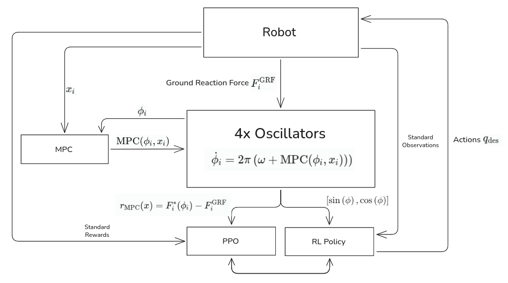

<!--
Copy this template for each proposal and replace the title, names, and prompts.
The headings are a starting point; adapt them if another structure communicates
your idea more clearly. This is an exploration, so say what you are still unsure about.
Include related work where it helps explain your idea.

Build from the folder containing your copy:
  pandoc project_outline.md --from=gfm+raw_attribute+smart --pdf-engine=pdflatex -o project_outline.pdf

The matching LaTeX template is generated with:
  pandoc project_outline.md --from=gfm+raw_attribute+smart --standalone -o project_outline.tex
-->

# *Performance Driven Idea*

## Context

The paper *"Learning Emergent Gaits with Decentralized Phase Oscillators: on the role of Observations, Rewards, and Feedback"* explores how gaits can naturally emerge in a quadruped robot using four decentralized oscillators, one for each leg. The RL policy receives a phase-based reward that encourages leg-to-ground contact during the stance phase and penalizes it during the swing phase:
$$\begin{equation}
r_{\text{gait}}(x)=-F_i^{\text{GRF}}sin(\phi_i)
\end{equation}$$

At runtime, the oscillator phases are accessible by the RL policy. Testing showed that this approach allowed the robot to naturally develop coordinated gaits with high disturbance rejection. The oscillator dynamics introduced in the paper are given by:
$$\begin{equation}
\dot{\phi}_i = 2\pi\left(\omega - \sigma F_i^{\mathrm{GRF}}\left(\cos(\phi_i) + \xi\right)\right)
\end{equation}$$

where $\omega$ is the nominal frequency, $\sigma$ the feedback gain and $\xi$ an offset. Coordination between the legs can emerge via the ground-reaction forces without explicitly prescribing a gait.

## Contribution

While this approach shows promising results for locomotion on flat ground, we are interested in investigating its capability to navigate more complex terrain such as stairs. Despite their increased complexity, such tasks still involve cyclic movements across the legs, suggesting that decentralized oscillators could remain beneficial. We propose replacing the original force-feedback law with Model Predictive Control (MPC) adjusting the frequency of each oscillator based on the predicted motion of the robot. The objective is to allow the robot to naturally adapt its gait to different tasks without having to train a new policy.

The proposed oscillator dynamics are given by:
$$\begin{equation}
\dot{\phi}_i = 2\pi\left(\omega + \text{MPC}(\phi_i,x_i))\right)
\end{equation}$$

We still have no explicit coupling between the oscillators. We also propose defining a desired ground reaction force profile $\mathbf F_i^*(\phi_i)$ for each oscillator.
Rather than only rewarding contact during stance, the RL policy would be rewarded for reproducing the desired force at each phase:
$$\begin{equation}
r_{\text{MPC}}(x)=F_i^*(\phi_i)-F_i^{\text{GRF}}
\end{equation}$$

The desired force would be zero during swing and follow a chosen force profile during ground contact. By training the RL policy to reproduce these forces, the MPC controller can adjust the oscillator rates and predict the resulting motion based on the expected ground reaction forces $F_i^*(\phi_i)$. We hope the RL policy will allow us to treat the complex quadruped dynamics as a simpler model with ground reaction forces on a rigid body.

{ width=425px }

## Proposed Experimental Steps and Success Criterias

### Phase 1a: Locomotion without MPC (no force profile)
First, we will test the robot on flat ground with a fixed gait that we engineer manually. We will start by rewarding stance/swing similar to equation (1) without asking for specific forces. This phase will allow us to evaluate the RL policy's ability to maintain stability and simultaneously track and oscillator-prescribed gait. We will track metrics like how often the robot falls over after a set of random initializations and _gait overlap_: the total amount of time the policy matches the prescribed stance/swing for each leg. We will visualize this with gait diagrams. This phase will be successful if the stable percentage is very high and gait overlap is nearly the length of the rollout. We may attempt to preliminarily transfer to real at this stage.

### Phase 1b: Locomotion without MPC (with force profile)
We will then incorporate rewards for specific force profiles like in equation (4). We will train the policy over random force profiles. In addition to the metrics from 1a, we will track mean deviation from the requested force.

### Phase 2: MPC control on flat ground
We will then integrate the MPC controller into the oscillator dynamics, as described in equation (3), while keeping the same RL policy. The MPC will guide the robot between predefined waypoints in a flat environment. In addition to our earlier metrics, we will try to measure the optimality of the trajectory (was the path short?). We will also measure how well the robot is able to follow the desired trajectory from MPC and observe the emergence of different gaits. This phase will be considered successful if the robot is able to move between waypoints in many tests. We will transfer to real if we observe this in sim.

### Phase 3: MPC control on complex terrain
Finally, we will test the controller on more challenging tasks, particularly stairs, without providing information about terrain geometry to the RL policy (the MPC will handle terrain geometry). We will use the same performance metrics as in earlier phases, and additionally test the robot's ability to successfully climb stairs of increasing height. We will also observe how its gait adapts to changes in ground contact.
